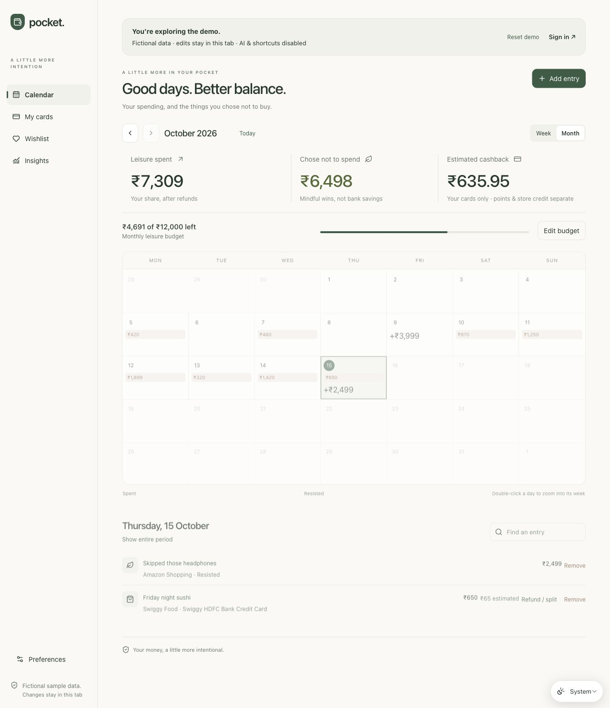
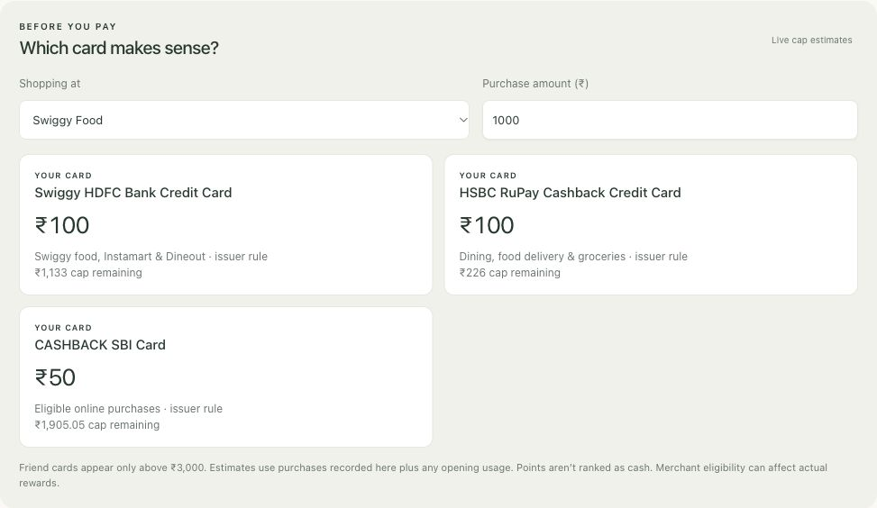
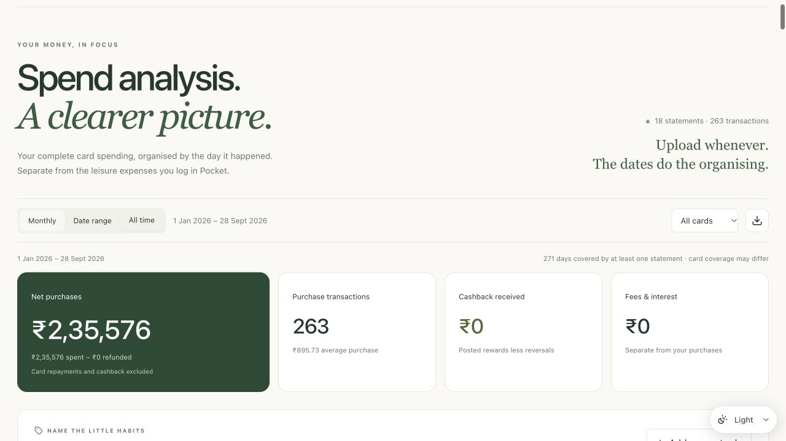
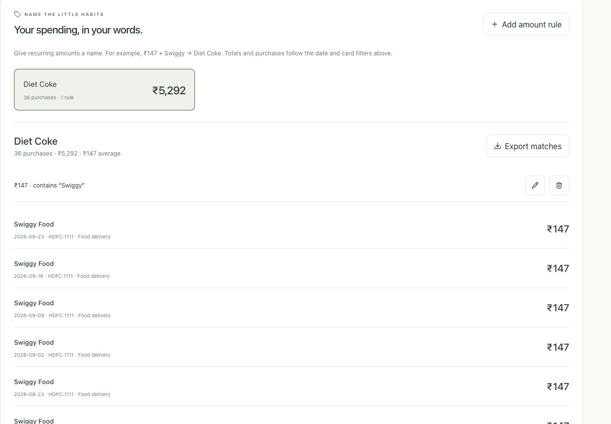
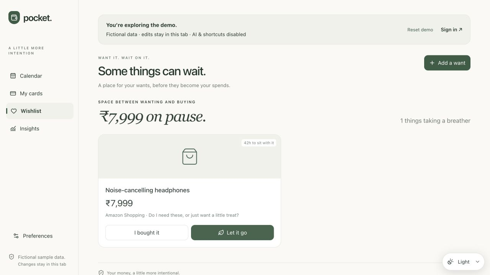
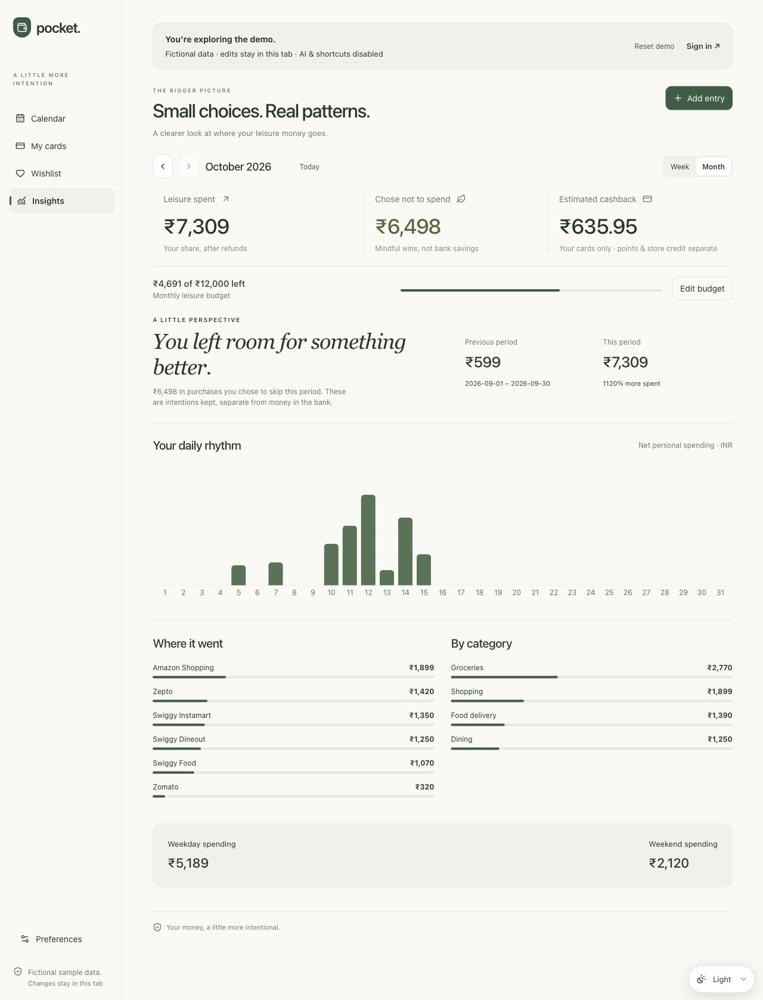
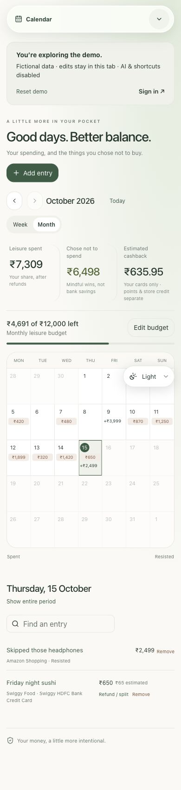
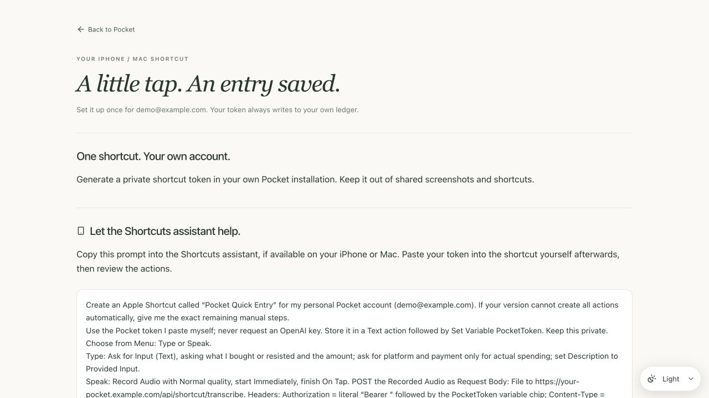

# Pocket — yet another expense tracker, but better

A self-hosted personal money manager: spending calendar, credit-card reward estimates, voice-assisted entries, and a statement-based spending dashboard. Invite a small group with separate accounts, or keep it entirely personal.

Next.js · React · TypeScript · private Vercel Blob storage · optional OpenAI API

## What is included

- Monthly/weekly calendar, leisure budgets, refunds, shared purchases and resisted purchases.
- Searchable Indian card catalogue, custom cards/platforms, estimated cashback with caps and billing cycles, points and friend-card restrictions.
- Text-based entry extraction and multilingual audio transcription, with manual entry available without an AI key.
- Personalised iPhone Shortcuts setup, token management, replay protection and undo.
- Owner-only HDFC/HSBC statement imports: transaction-date analysis, categories, spending trends/projections, habits, missed-cashback scenarios, one-offs, biggest purchases and custom amount labels.
- Invite-only beta accounts, owner dashboard, account export/recovery and visitor/demo analytics.
- Light/dark/system appearance, mobile navigation and a public demo with fictional data and no AI calls.

New installations start with **no cards and no financial records**, including the owner. Onboarding collects your budget/payment modes. Add your own cards from the catalogue or create custom rules. Test fixtures are synthetic and are not seeded into your account.

## See Pocket in action

All app screenshots below use **fictional demo data**. No personal statements, recordings, API keys or shortcut tokens are shown. The iPhone flow is an illustration; native iOS appearance varies by version.

### A calendar for spending and the things you resisted

Switch between month and week views, see your leisure budget, track estimated cashback, and keep avoided purchases separate from money actually spent.



### Back Tap. Speak. Saved.

Run **Pocket Quick Entry** through iPhone Back Tap, choose **Type** or **Speak**, and describe the purchase. Speak records audio for server-side transcription; Pocket interprets the description and calculates cashback using your configured rules. Missing details trigger clarification rather than a guessed entry. After saving, you can **Keep** or **Undo**.


Open **Create shortcut** in your own installation for personalised endpoints, a revocable account token, manual actions, and a copyable Shortcuts-assistant prompt. Your OpenAI key stays on the server. See [the shortcut setup overview](docs/IPHONE_SHORTCUT.md).

### Know which card makes sense

Compare estimated rewards before paying, inspect remaining caps, choose from the searchable Indian card catalogue, or add your own card and benefit rules. Points and friend-owned cards stay distinct from your own cashback.



### Understand where your money goes

Import supported statements and explore spending by **transaction date**, not upload date. Filter by month, all time, custom dates or card. The spending line separates recorded totals from projections and lets you try a reduction scenario. Leisure entries and total card spending remain separate.


<details>
<summary><strong>More feature snapshots: statement overview, amount labels, wishlist, insights, mobile and shortcut setup</strong></summary>

### Statement overview

Net purchases, transaction counts, posted cashback and fees are shown separately. Original PDFs are not stored.



### Put a name to recurring purchases

Create exact-amount or amount-range rules, optionally restricted to a merchant. For example, **₹147 + Swiggy → Diet Coke**. View matching purchases, count, total and average; combine several prices under one label. Rules apply to past purchases and future imports without rewriting their original categories.



### Give impulse purchases a little time

The cooling-off wishlist gives a planned purchase a waiting period before you decide to buy it or resist it.



### See your leisure habits

Explore daily spending, platform totals and category breakdowns alongside spending you chose to avoid.



### A mobile-friendly daily view

The calendar and navigation adapt to a small screen. Light, dark and system appearances are available throughout the app.



### Guided shortcut setup

The actual guide provides a copyable assistant prompt and manual instructions. This screenshot uses an example account and domain, with no token generated or displayed.



</details>

## Quick start

Use Node.js 24 LTS (Node 22.13+ is also supported).

```sh
npm ci
npm run setup
```

Setup creates `.env.local` from the empty template, generates a strong owner password and session secret, and enables repository-local secret-check hooks when this is a Git checkout. Running setup again preserves existing credentials.

1. Create **your own private Vercel Blob store** in your Vercel project. Copy its `BLOB_READ_WRITE_TOKEN` into `.env.local`. Do not use a public Blob store or someone else's token.
2. Set `POCKET_OWNER_EMAIL` to your email. Set `POCKET_PUBLIC_URL=http://localhost:3000` for local development.
3. Optional: set `OPENAI_API_KEY` to your own API key. Leave it blank for manual entry, manual statement categorisation and the other non-AI features. AI entry, voice transcription and online merchant research need a funded key with access to the configured models.
4. Privately open `.pocket-access.txt` for the generated password. Never commit, upload, screenshot or share that file.
5. Verify configuration and start:

```sh
npm run config:check
npm run dev
```

Open http://localhost:3000, sign in using your owner email and generated password, and complete onboarding. The `/demo` route works without storage credentials and uses fictional, browser-local data. No public signup or email delivery service is required.

## Configuration

All credentials are **server-side environment variables**. Never prefix an API key, Blob token, password hash or session secret with `NEXT_PUBLIC_`.

- `BLOB_READ_WRITE_TOKEN` — required; token for your private Blob store. This grants the server access to all data in that store, so use a dedicated store for Pocket.
- `POCKET_OWNER_EMAIL` — required; the operator/owner email, also used for support contact.
- `POCKET_PASSWORD_HASH` and `POCKET_SESSION_SECRET` — required; generated by setup. The plaintext password is only in the ignored local access file.
- `POCKET_PUBLIC_URL` — your own canonical origin. Use `https://YOUR-PROJECT.vercel.app` in production. Shortcut guides use this value, never the original Pocket deployment. Local HTTP is allowed only for localhost development.
- `OPENAI_API_KEY` — optional; your server-side OpenAI key. The browser and Shortcuts receive only Pocket's own scoped shortcut token.
- `OPENAI_ENTRY_MODEL` — optional; defaults to `gpt-4.1-mini`, requires Responses API structured outputs.
- `OPENAI_TRANSCRIPTION_MODEL` — optional; defaults to `gpt-4o-mini-transcribe`, requires audio transcription support.
- `OPENAI_RESEARCH_MODEL` — optional; defaults to `gpt-4.1-mini`, requires Responses API web search and structured outputs.

Provider pricing, model availability and card benefits can change. No paid service is needed to run the fictional demo. Real persistent accounts need a private Blob store; AI features may incur provider charges.

## Deploy your own instance

1. Create a new Vercel project from your fork. Do **not** link it to an existing operator's project, account directory or Blob store.
2. Add the variables above in **Vercel Project Settings → Environment Variables**. Copy only the generated password hash and session secret, never the plaintext password file.
3. Set `POCKET_PUBLIC_URL` to your project's HTTPS origin, then deploy. If the origin changes, update it and redeploy.
4. Sign in, complete onboarding, and open `/shortcut` for instructions generated for your deployment. Each account creates its own revocable bearer token.
5. Preview/development and production use separate Blob prefixes. Keep preview credentials separate too where possible. Do not attach production secrets to untrusted fork pull requests.

The application password gate works on the ordinary `vercel.app` domain. No Clerk account, custom domain, Neon account, ChatGPT account or Sites connector is required.

## Data and operational limits

Private JSON snapshots use conditional ETag writes: conflicts ask you to refresh rather than silently overwrite changes. Ledgers are scoped to server-authenticated account IDs. Statement analysis remains owner-only and does not alter the separate leisure ledger. Original PDFs are parsed but not saved.

The beta directory supports up to 20 accounts. The statement workspace supports 200 statements and 15,000 transactions. Blob snapshots suit personal/small-group use; this is not a large multi-tenant database architecture. Before a larger rollout, replace the storage adapter with transactional storage and reassess abuse protection and operational monitoring.

AI limits are request ceilings, not currency budgets. Configure spending limits in your provider account. User data sent to AI: entry descriptions for extraction, audio for transcription, and business merchant names for research. Extraction/research requests set `store:false`; provider retention policies still apply. The operator has infrastructure-level access to hosted user data.

Cashback, projections, annualised habits and card-switch comparisons are estimates. Verify issuer terms, MCC/MID eligibility, exclusions, billing dates, cap usage and posted rewards. Custom amount labels describe your assumptions; a statement cannot prove what item was purchased.

## Development and checks

```sh
npm run check
npm run build
```

Checks cover security exclusions, lint, TypeScript, parser/reward/account isolation/entry/analytics tests, and a production build. Tests use synthetic fixtures and mocks; they require no API keys and make no paid AI calls. The build also works without credentials. A fully authenticated runtime requires the configuration above.

See [CONTRIBUTING.md](CONTRIBUTING.md), [SECURITY.md](SECURITY.md), [docs/ARCHITECTURE.md](docs/ARCHITECTURE.md), and [docs/STATEMENT_FORMATS.md](docs/STATEMENT_FORMATS.md).

## Licence

Pocket code is MIT licensed. See [LICENSE](LICENSE) and [THIRD_PARTY_NOTICES.md](THIRD_PARTY_NOTICES.md). Card and merchant trademarks belong to their respective owners; this project is not affiliated with the issuers. The catalogue is curated, dated research with source attribution, not an issuer API or a guarantee of eligibility.
