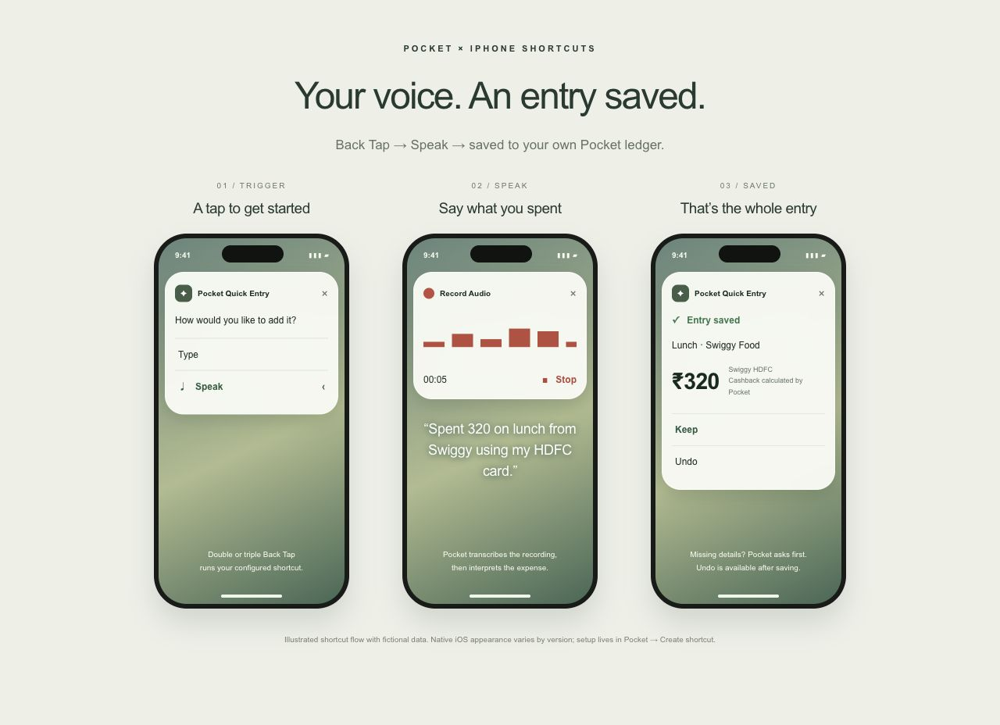

# iPhone quick entry

Pocket supplies personalised instructions at **Create shortcut** (`/shortcut`) after sign-in. Use the endpoints shown by your own deployment, not another operator's URL. Never share screenshots or exported shortcuts that include your token.

This is an illustrated explanation with invented data, not a recording or exact reproduction of every iOS version's UI.

## What happens

1. Configure Back Tap to run your **Pocket Quick Entry** shortcut.
2. Choose **Type** or **Speak**. Type asks for text; Speak uses Shortcuts' Record Audio action.
3. For speech, the shortcut sends the audio to Pocket's transcription endpoint and continues only after a successful transcript.
4. The shortcut sends the description and a reusable request ID to the entry endpoint. Pocket interprets it, validates it, and calculates rewards deterministically from your configured card rules.
5. A complete entry is saved. Missing details cause a follow-up question without saving an incomplete entry. Keep the same request ID while clarifying/retrying.
6. Choose **Keep** or **Undo** after saving. Shortcut undo is available within 15 minutes.

Example description: “Spent 320 on lunch from Swiggy using my HDFC card.” Use your exact configured payment name where possible. For a resisted purchase, say what you avoided and its amount; a platform/payment is not required.

## Set it up

Open `/shortcut` in your own instance. Generate your own revocable shortcut token and follow the manual guide, or copy the personalised prompt into the Shortcuts assistant if your OS provides it. Insert the token privately afterwards and review the generated actions.

For Back Tap: iPhone Settings → Accessibility → Touch → Back Tap → Double Tap or Triple Tap → your shortcut. On Mac, run it from Shortcuts or assign a keyboard shortcut. Assistant support and native appearance vary by OS version.

The guide includes your configured base URL, transcription/entry/undo endpoints, request formats and error handling. Authentication uses `Authorization: Bearer <your Pocket token>`, including the space after `Bearer`. The OpenAI key stays in server environment variables and is never pasted into Shortcuts.

Recordings must fit the upload limit (4 MB). Voice normally uses two AI requests: transcription and extraction. Provider charges and your account quota apply; manual web entry remains available without AI. The public fictional demo deliberately disables AI and shortcuts.
